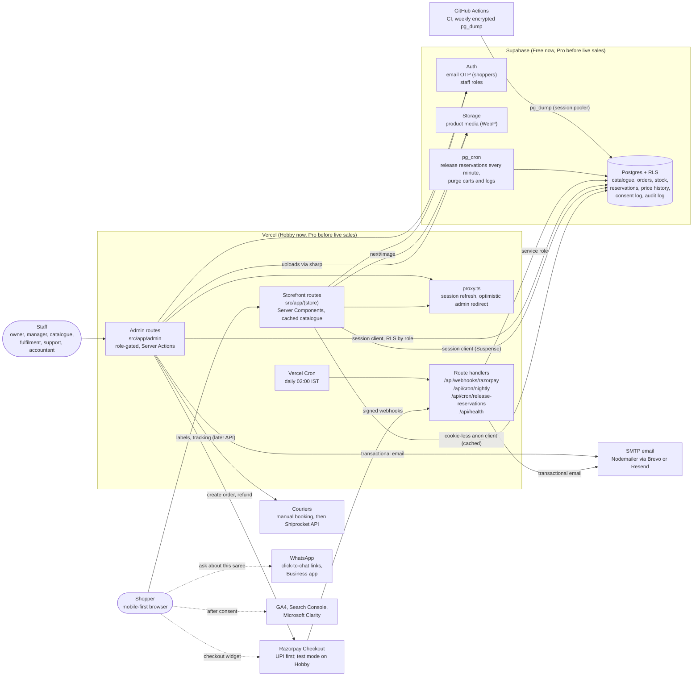
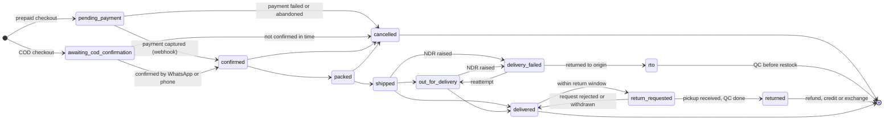

# Architecture

Bahram Silks is one Next.js 16 application that serves the storefront, the admin panel and a few
route handlers. Supabase holds all state. External services are called from the server only, except
Razorpay Checkout and analytics, which run in the shopper's browser.

> The kickoff brief's architecture caption mentions a Medusa backend; Medusa was dropped (see
> [ADR 0001](adr/0001-stack-nextjs-supabase-free-tier.md) and [kickoff notes](kickoff-notes.md)).
> This page is the current picture.

## System context

### Responsibilities

| Part                           | Owns                                                                            | Notes                                                                                                                 |
| ------------------------------ | ------------------------------------------------------------------------------- | --------------------------------------------------------------------------------------------------------------------- |
| Storefront (`src/app/(store)`) | Catalogue, product pages, cart, checkout, account, craft content                | Public reads are `"use cache"` + `cacheTag` with a cookie-less client ([ADR 0006](adr/0006-caching-and-rendering.md)) |
| Admin (`src/app/admin`)        | Every back-office module from the brief                                         | Staff roles from `STAFF_ROLES`; checks in the data layer, not only in `proxy.ts`                                      |
| Domain (`src/lib/domain`)      | Money, pricing, claims, order state machine, reservations rules                 | Pure functions, no I/O, unit-tested                                                                                   |
| Route handlers (`src/app/api`) | Razorpay webhook (source of truth for payment state), cron entry points, health | Cron endpoints require `Authorization: Bearer $CRON_SECRET`                                                           |
| Postgres                       | All state, constraints, reservation locking, RLS                                | Enums mirror `src/lib/domain/enums.ts` exactly                                                                        |
| pg_cron                        | Per-minute reservation expiry, housekeeping                                     | Primary scheduler; Vercel Cron is the daily backstop                                                                  |
| Storage                        | Product images and videos                                                       | No blobs in Postgres; public bucket, private bucket for invoices                                                      |

## Order lifecycle

Twelve states, exactly `ORDER_STATUSES` in `src/lib/domain/enums.ts`. Allowed transitions live in
`src/lib/domain/orders/state-machine.ts`; this diagram must match it. Every transition sends the
customer a message and creates an admin task.

Stock follows the order ([ADR 0003](adr/0003-one-of-a-kind-stock-reservations.md)): reserved at
checkout start, committed on `confirmed`, released on `cancelled`, and restocked from `rto` or
`returned` only after quality check (`returned_restock` adjustment) or written off
(`damaged_write_off`). Return requests have their own sub-workflow (`RETURN_STATUSES`: requested,
approved, pickup scheduled, received, QC, then refund to source, store credit or exchange).

## Environments

| Environment | App                                    | Database                    | Payments                                             |
| ----------- | -------------------------------------- | --------------------------- | ---------------------------------------------------- |
| Local       | `npm run dev` on http://localhost:3020 | Supabase CLI in Docker      | Razorpay test keys                                   |
| CI          | `next build` + `next start`            | Supabase CLI in the runner  | Placeholder test keys (smoke tests do not pay)       |
| Preview     | Vercel preview deploys                 | Staging Supabase project    | Razorpay test keys                                   |
| Production  | Vercel (Pro before live sales)         | Production Supabase project | Test keys until [going live](runbooks/going-live.md) |
